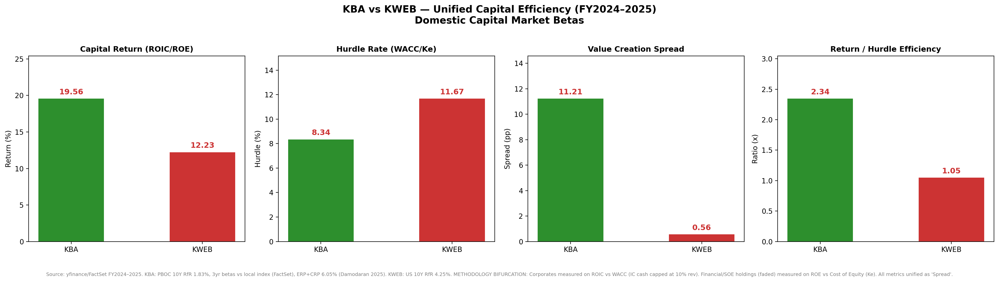
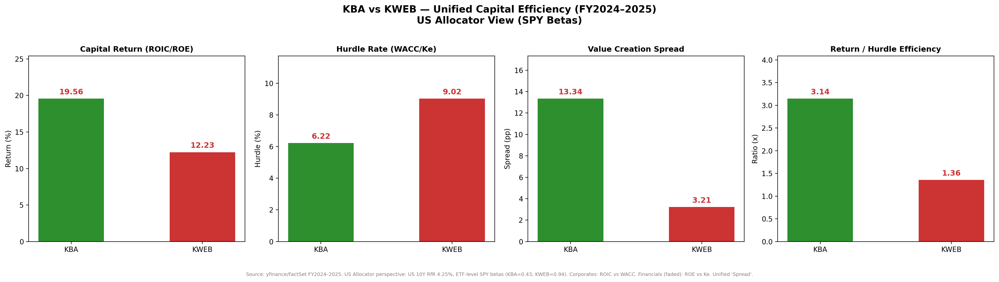

# KBA vs KWEB: Where China Earns Its Cost of Capital

**Inesh Pulugurtha** · Kelley School of Business, Indiana University  
March 2026 valuation, refreshed 30 October 2026

KraneShares Bosera MSCI China A 50 Connect Index ETF (**KBA**) earns far more than its cost of capital. KraneShares CSI China Internet ETF (**KWEB**) earns roughly its cost of capital in the March snapshot, and falls short of it once the books and the US 10-year are updated through 30 October 2026.

The test is holdings-level economic profit. Corporates are scored on return on invested capital against WACC. Banks, insurers, and other financials are scored on return on equity against the cost of equity. Both are reported as one number: the **spread**, in percentage points.

|  | KBA | KWEB |
|---|---:|---:|
| Capital return (ROIC / ROE) | 19.6% | 12.2% |
| Domestic hurdle (WACC / Ke) | 8.3% | 11.7% |
| **Domestic spread** | **+11.2 pp** | **+0.6 pp** |
| US-allocator spread | +13.3 pp | +3.2 pp |
| Return / domestic hurdle | 2.3x | 1.0x |
| Covered weight with a positive domestic spread | 92% | 50% |

Weights are the study’s approximate constituent weights. They are not rescaled to 100, and they are not an official holdings file. Averages use only names with a usable statement: 47 of 48 KBA names (72.2 weight points) and 23 of 29 KWEB names (70.3 weight points).



*Domestic view. KBA hurdles use the China 10-year and each stock’s FactSet beta. KWEB hurdles use the US 10-year, because the book is listed in Hong Kong and the United States.*



*US-allocator view. Every name is charged the US 10-year and the ETF’s beta versus SPY: 0.43 for KBA and 0.94 for KWEB.*

## What the spread is measuring

A positive spread means the holding’s latest annual return sits above the return a capital provider would require for that risk. A wide spread is value creation inside the business. It is not a target price, and it is not a forecast of the ETF.

Two lenses, same financials:

- **Domestic.** KBA is an onshore A-share book, so its risk-free rate is the China 10-year (1.83% in March) and its betas are FactSet stock betas. KWEB’s listings are offshore, so its risk-free rate is the US 10-year (4.25%).
- **US allocator.** Both books are charged the US 10-year and a single ETF beta versus SPY. Stock-level beta differences drop out. KBA’s hurdle falls by more, because 0.43 is well below the typical A-share beta in this book, and its spread widens to +13.3 pp. KWEB’s spread widens to +3.2 pp.

The engine treats the two kinds of businesses differently, then puts them back on one scale:

- **Corporates.** After-tax operating income divided by invested capital. Invested capital is equity plus debt, minus cash, with the cash deduction capped at 10% of revenue so a net-cash balance sheet is not turned into an infinite ROIC. The hurdle is WACC.
- **Financials.** Net income divided by equity. The hurdle is the cost of equity only. Deposits and float are the raw material of these businesses, so a corporate ROIC is the wrong denominator. Names in Financial & Construction SOE and in Fintech & Insurance take this path, which also puts the construction SOEs on ROE.

Cost of equity is the risk-free rate plus beta times 6.05%. That 6.05% is Damodaran’s 2025 equity risk premium with country risk already inside it, so country risk is not added again. The tax rate used to unlever the cost of debt and to compute after-tax operating profit is 15%. Pre-tax cost of debt is 3.5% for the A-share book and 5.0% for the offshore book. A name is dropped when the absolute ROIC or ROE exceeds 100%, which is treated as a statement-mapping error rather than an economic result.

FactSet FY25 actuals override the pull for the financial heavyweights that a live feed tends to drop or distort, and for BYD and NetEase. Every other March figure is the latest annual statement available from Yahoo Finance at the time of the run. Fiscal years in the snapshot mix FY2024 and FY2025. Stock betas are the FactSet set stored in the model. Where a FactSet beta is absent, the model falls back to a sector beta.

## October 2026 refresh

`aging_check.py` asks whether the March conclusion was a snapshot of stale statements or a feature of the two businesses. Three things move, and the betas do not:

- Latest annual statements, pulled again. The March FactSet overrides are not frozen, so the refresh is a live-statement test. Wanhua Chemical is the one KBA name carried forward from the March file when the new pull failed.
- China 10-year, from 1.83% to 1.65%. US 10-year, from 4.25% to 4.94%. Both as of the 30 October 2026 close.
- Cost of debt, shifted by the same number of basis points as the matching risk-free rate. The equity risk premium stays at 6.05%. The March FactSet betas and the March ETF betas versus SPY stay in place, so the comparison is fundamentals and rates.

|  | KBA March | KBA 30 Oct | KWEB March | KWEB 30 Oct |
|---|---:|---:|---:|---:|
| Capital return | 19.56% | 18.61% | 12.23% | 8.10% |
| Domestic spread | +11.21 pp | +10.47 pp | +0.56 pp | −4.12 pp |
| Spread if only the statements changed | +11.21 pp | +10.30 pp | +0.56 pp | −3.45 pp |
| US-allocator spread | +13.34 pp | +11.89 pp | +3.21 pp | −1.55 pp |

KBA gives back about 0.9 percentage points of return. The lower China yield gives a little of that back through a lower hurdle, and the domestic spread is still about +10.5 pp. KWEB’s return falls 4.1 percentage points. That operating move accounts for most of the spread compression. The higher US 10-year takes the rest, and the domestic spread finishes at −4.1 pp. On the US-allocator lens KWEB is also below its hurdle, at −1.6 pp, while KBA remains wide at +11.9 pp.

The comparison is limited to names present in both snapshots, at the original weights: the same 47 KBA names and 23 KWEB names.

## Exhibits

Domestic detail, each holding’s return against its hurdle. Financials are drawn lighter, because they are on ROE rather than ROIC.

- [KBA holdings, domestic](output/chart2_kba_detail_domestic.png)
- [KWEB holdings, domestic](output/chart3_kweb_detail_domestic.png)

Same holdings with the US-allocator hurdle:

- [KBA holdings, US allocator](output/chart5_kba_detail_spy.png)
- [KWEB holdings, US allocator](output/chart6_kweb_detail_spy.png)

The row-level file for the March run is [`output/unified_analysis_data.csv`](output/unified_analysis_data.csv). The October comparison, including the statement-only hurdle, is [`output/aging_20261030/aging_comparison.csv`](output/aging_20261030/aging_comparison.csv).

Names with the widest March domestic spreads are Kweichow Moutai (+38.3 pp), Shaanxi Coal (+35.4 pp), Shanxi Xinghuacun Fen Wine (+32.2 pp), and BYD (+30.3 pp) inside KBA, and PDD (+23.3 pp) and NetEase (+15.8 pp) inside KWEB. The narrow end of KWEB is Bilibili (−23.3 pp), East Buy (−15.6 pp), and JD Health (−13.7 pp). Tencent, the largest KWEB weight in the study at 10 points, clears its domestic hurdle by 4.6 pp.

## Reproduce

```bash
pip install -r requirements.txt
python kba_kweb_full_analysis_audited.py
python aging_check.py
```

The first script rebuilds the March exhibits in `output/`. The second writes `output/aging_20261030/aging_comparison.csv` and leaves the March CSV in place. A fresh run hits Yahoo Finance, so totals will drift from the files published here. Those files are the record of this study.

## Scope

- The covered book is an approximate large-holding slice. Listed weights sum to 72.9 for KBA and 78.8 for KWEB. COSCO Shipping dropped out of KBA for lack of a usable statement. Trip.com, Full Truck Alliance, Vipshop, JOYY, QFIN, and Weibo dropped out of KWEB.
- Several A-share betas in the FactSet set are near zero or negative, including China Yangtze Power, ICBC, and Bank of China. Those hurdles are low because the regression said the stock did not move with the market. They are reported as estimated, not overridden.
- Construction SOEs sit in the financial bucket because of the sector label used in the holdings file. Their spread is an ROE spread.
- Nothing here is a recommendation to buy or sell either fund.

## Repository

| Path | Role |
|---|---|
| `kba_kweb_full_analysis_audited.py` | Valuation model: holdings, FactSet betas, ROIC / ROE, WACC / Ke, charts |
| `aging_check.py` | 30 October 2026 refresh of statements and risk-free rates |
| `output/` | March exhibits and the holdings-level valuation file |
| `output/aging_20261030/` | October comparison against the March snapshot |
